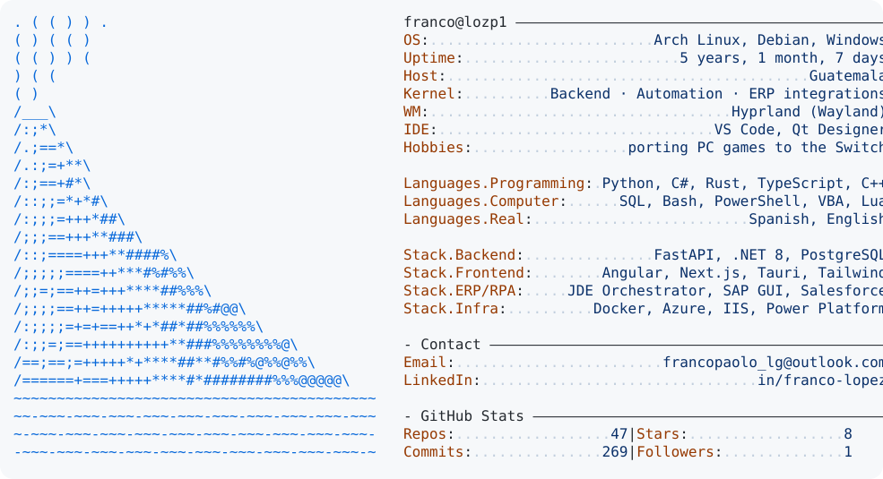

<a href="https://github.com/lozp1/lozp1">
  <picture>
    <source media="(prefers-color-scheme: dark)" srcset="https://raw.githubusercontent.com/lozp1/lozp1/master/dark_mode.svg">
    
  </picture>
</a>

### 🔭 Now building

- **Magnus SaaS Core** — moving a VBA monolith to a web platform: FastAPI · SQLAlchemy · Next.js · PostgreSQL · Docker Compose.
- **Andromeda Download** — download manager with a Rust/Tokio engine (up to 32 parallel sockets) and an Angular + Tauri UI.
- **Wine on the Switch** — FIFA 07 and GTA San Andreas running on the console with Wine + FEX + DXVK.

### 🚀 Projects

<table>
<tr>
<td width="50%" valign="top">

**⚙️ Automation & integrations**

- **Magnus RPA** — SAP GUI Scripting + PySide6 (QThread). Cut a 16 h batch to 3.5 h (−78%).
- **Magnus MK** — QR letters in seconds through the Salesforce SOAP/REST and Microsoft Graph APIs (−99% vs. Data Loader).
- **JD Edwards Orchestrator** — orchestrations in Orchestrator Studio (form and data requests, UBE report execution, PDF download and messages with attachments) exposed through AIS REST.
- **FEL e-invoicing** — integrations with Infile, Edicom and GuateFactura: XML validation and certification debugging.
- **Power Platform flows** — risk traffic-light classification in Power Automate and Power BI ETL pipelines.
- [**vbWhatsapp**](https://github.com/lozp1/vbWhatsapp) — bulk WhatsApp Web messaging with Selenium driven from VBA.

</td>
<td width="50%" valign="top">

**🖥️ Web & desktop apps**

- [**Andromeda Download**](https://github.com/lozp1/AndromedaDownload) — Rust · Tokio · Tauri 2 · Angular.
- **Aralia** — a poetry writing workshop: Angular 18 · FastAPI · PostgreSQL · Tauri.
- **Fixed-Asset Portal** — employees look up the assets assigned to them in JD Edwards, see a photo of each item and get their responsibility card as a PDF by email. Angular 19 + Tailwind → .NET 8 Web API → JDE Orchestrator (AIS); WebP image pipeline (SkiaSharp), per-IP rate limiting, deployed on IIS.
- **auditorGT** — modular ETL pipeline (extract / transform / load) for public data, with DrissionPage and BeautifulSoup.
- **Gemini Blur** — Chrome extension for DOM manipulation in vanilla JS.

</td>
</tr>
<tr>
<td width="50%" valign="top">

**🎮 Nintendo Switch homebrew**

- [**07z**](https://github.com/lozp1/07z) — FIFA 07 on the Switch: own frontend, HOME icon and Wine hidden in the background.
- **gtasa-nx** — GTA San Andreas on the Switch, with CPU/EMC clock tuning and a mod manager.
- [**FileZzz**](https://github.com/lozp1/FileZzz) — file manager with USB MTP and FTP server.
- [**pokemon-rng-automation**](https://github.com/lozp1/pokemon-rng-automation) — Lua RNG scripts.

</td>
<td width="50%" valign="top">

**🐧 Lab & environment**

- **Home lab** — Debian server over SSH with containerized services.
- **Workstation** — Arch Linux + Wayland/Hyprland, Bash-scripted dev flows.
- **Cross-OS by design** — I develop on Linux and ship to Windows.

</td>
</tr>
</table>

---

### 🧰 Tech stack

| | |
|:--|:--|
| **Backend** |  |
| **Frontend & desktop** |  |
| **Automation** |  |
| **Infra & tools** |  |
| **Low level** |  |

Also: JD Edwards Orchestrator · SAP GUI Scripting · Power Automate · Power BI (Power Query/M) · Microsoft Graph · Pandas · Pydantic · Crystal Reports · devkitPro · Wine · FEX · DXVK

---

<picture>
  <source media="(prefers-color-scheme: dark)" srcset="https://raw.githubusercontent.com/lozp1/lozp1/output/github-contribution-grid-snake-dark.svg">
  <source media="(prefers-color-scheme: light)" srcset="https://raw.githubusercontent.com/lozp1/lozp1/output/github-contribution-grid-snake.svg">
  
</picture>

